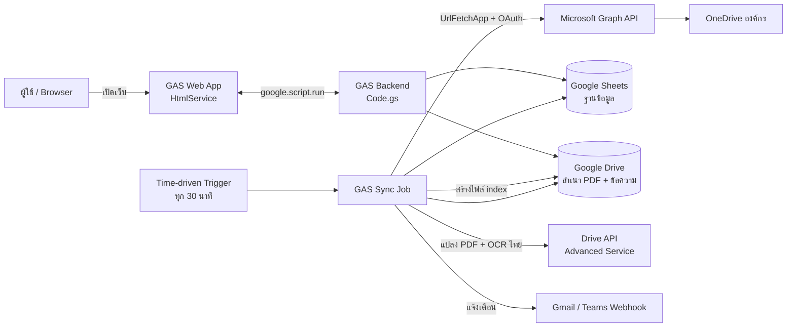
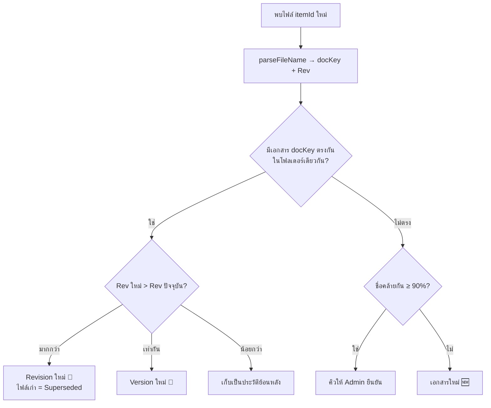
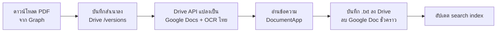

# Document Schematic — System Design

Web app สำหรับรวมเอกสาร PDF จาก OneDrive องค์กร ไว้ที่เดียว ค้นหาได้ และติดตามการแก้ไขของเอกสาร (Revised / Updated)

> **v3** — **ต้องใช้งานได้ฟรีทั้งหมด** ใช้ **Google Apps Script (GAS)** เป็นตัวกลาง
> เงื่อนไขจาก v2 ยังคงเดิม: OneDrive องค์กร + แชร์ลิงก์, ชื่อไฟล์อิสระต่อท้ายด้วย `Rev.N`, บางครั้งอัปเดตโดยไม่เปลี่ยนเลข Rev, ไฟล์ส่วนใหญ่เป็น PDF

---

## 1. เลือกแพลตฟอร์ม (ฟรีเท่านั้น)

| ทางเลือก | ข้อดี | ข้อเสีย | สรุป |
|---|---|---|---|
| **A. Google Apps Script + Sheets + Drive** | ฟรีจริง ไม่ต้องมีเซิร์ฟเวอร์, มี time trigger, **Google Drive OCR ภาษาไทยได้ฟรี**, เก็บไฟล์ได้ 15 GB | มี quota (รันได้ครั้งละ 6 นาที), หน้าเว็บช้ากว่าเว็บทั่วไปเล็กน้อย | ✅ **แนะนำ** |
| B. Power Automate + SharePoint (ของ Microsoft 365 ที่องค์กรมีอยู่) | อยู่ใน license M365 แล้ว, SharePoint มี version history + ค้นหาไทยในตัว | ปรับแต่งหน้าเว็บ/ตรรกะ Rev ได้น้อย, flow บางตัวต้องใช้ premium connector | ทางเลือกถ้าอยากใช้ของ Microsoft ล้วน |
| C. Cloudflare Workers + D1 + R2 + Pages | free tier สูง เว็บเร็วมาก | **แตกข้อความ/OCR PDF ภาษาไทยไม่ได้** (จำกัด CPU) | ไม่เหมาะกับงาน PDF |
| D. Docker บนเซิร์ฟเวอร์ (แบบ v2) | ทำได้ทุกอย่าง | ต้องมีเครื่องเปิดตลอด (ค่าไฟ/ดูแลระบบ), cloud ฟรีอย่าง Oracle Always Free ต้องใช้บัตรเครดิตและอาจถูกเรียกคืน | ไม่ตรงเงื่อนไข "ฟรี" |

**ทำไม GAS เหมาะที่สุด:** จุดยากของระบบคือ **การอ่านข้อความภาษาไทยจาก PDF** — Google Drive แปลง PDF เป็น Google Docs พร้อม OCR ภาษาไทยได้ฟรีผ่าน Drive API ซึ่งแพลตฟอร์มฟรีอื่นทำไม่ได้

---

## 2. ภาพรวมสถาปัตยกรรม



| ส่วนประกอบ | ใช้อะไร (ฟรี) | หน้าที่ |
|---|---|---|
| หน้าเว็บ | **GAS HtmlService** — HTML ไฟล์เดียวที่ฝัง CSS (Tailwind compile แล้ว), ฟอนต์ และ JavaScript ไว้ครบ **ไม่โหลดจาก CDN** | ค้นหา, รายการเอกสาร, ดู PDF, ประวัติ, หน้า Admin |
| Backend | **GAS** (`doGet`, ฟังก์ชันที่เรียกผ่าน `google.script.run`) | API ให้หน้าเว็บ |
| Sync Job | **GAS time-driven trigger** | ดึงข้อมูลจาก OneDrive, แยก Rev, สร้างเวอร์ชัน |
| ฐานข้อมูล | **Google Sheets** (แยก sheet ตามตาราง) | metadata เอกสาร/เวอร์ชัน |
| เก็บไฟล์ | **Google Drive** (15 GB) | สำเนา PDF ทุกเวอร์ชัน, ข้อความที่แตกได้, ไฟล์ index ค้นหา |
| แตกข้อความ / OCR | **Drive API (Advanced Service)** แปลง PDF → Google Docs `ocrLanguage: 'th'` | ได้ข้อความไทยสำหรับค้นหา |
| เชื่อม OneDrive | **Microsoft Graph API** ผ่าน `UrlFetchApp` (การลงทะเบียน App ใน Entra ID ไม่มีค่าใช้จ่าย) | อ่านรายการไฟล์ + ดาวน์โหลด |
| แจ้งเตือน | **MailApp** / **Teams Workflows webhook** | แจ้งเมื่อเอกสาร Revised |
| ดู PDF | **Google Drive viewer** (`drive.google.com/file/d/<id>/preview`) | แสดงสำเนา PDF ในหน้าเว็บ ไม่ต้องใช้ PDF.js |
| ติดตั้ง/ตั้งค่า | **เมนูใน Google Sheet** (`onOpen`) | ติดตั้ง, ตั้งค่า, sync, ทดสอบ โดยไม่ต้องเข้า editor |
| จัดการโค้ด | ซอร์สใน `gas/` → `npm run build` → `dist/` 3 ไฟล์ (วางใน Apps Script หรือ `clasp push`) | |

**บัญชีที่ใช้:** สร้าง Gmail กลางของหน่วยงาน 1 บัญชี (เช่น `docs.yourteam@gmail.com`) เป็นเจ้าของ Script, Sheet และโฟลเดอร์ Drive เพื่อไม่ผูกกับบัญชีส่วนตัวของใคร

---

## 3. ข้อจำกัด (Quota) ของ GAS ฟรี และวิธีรับมือ

| Quota (บัญชี Gmail ฟรี) | ค่า | วิธีรับมือ |
|---|---|---|
| เวลารันต่อครั้ง | 6 นาที | ทำงานเป็น batch ประมวลผลทีละไม่กี่ไฟล์ แล้วเก็บตำแหน่งที่ทำค้างไว้ใน `PropertiesService` ให้รอบถัดไปทำต่อ |
| เวลารวมของ trigger ต่อวัน | 90 นาที | sync ทุก 30 นาที (48 รอบ/วัน) รอบปกติใช้ไม่กี่วินาที เพราะส่วนใหญ่แค่เทียบ `cTag` — งานหนัก (ดาวน์โหลด/OCR) เกิดเฉพาะไฟล์ที่เปลี่ยน |
| UrlFetch | 20,000 ครั้ง/วัน | เพียงพอมาก (listing โฟลเดอร์ใช้ ~1 call ต่อ 200 ไฟล์) |
| ขนาด response ของ UrlFetch | 50 MB | PDF ทั่วไปไม่เกิน |
| ส่งอีเมล | 100 ผู้รับ/วัน | รวมเป็นอีเมลสรุป (digest) แทนส่งทีละเอกสาร |
| Google Sheets | 10 ล้าน cell | เก็บแค่ metadata ไม่เก็บเนื้อหาในชีต |
| Google Drive | 15 GB (รวมกับ Gmail) | PDF 1,000 ไฟล์ × 3 เวอร์ชัน × ~1 MB ≈ 3 GB |
| รันพร้อมกัน | 30 executions | ใช้ `LockService` กัน sync ซ้อนกัน |

> ถ้าอนาคตปริมาณงานเกิน quota: ย้าย Script ไปบัญชี Google Workspace (trigger 6 ชม./วัน) โดยโค้ดไม่ต้องเปลี่ยน

---

## 4. การเชื่อมต่อ OneDrive องค์กร

### 4.1 วิธีเข้าถึง (เลือกตามสิทธิ์ที่ได้จาก IT)

| ระดับ | วิธี | ต้องการอะไร | ทำอะไรได้ |
|---|---|---|---|
| **1 (แนะนำ)** | Graph API แบบ **Application** (client credentials) | IT Admin ลงทะเบียน App + Grant admin consent `Files.Read.All` | ทุกอย่าง: อ่านโฟลเดอร์, ตรวจไฟล์ใหม่/เปลี่ยน อัตโนมัติ |
| **2** | Graph API แบบ **Delegated** — login บัญชี Microsoft ครั้งเดียวผ่านไลบรารี [apps-script-oauth2](https://github.com/googleworkspace/apps-script-oauth2) แล้วเก็บ refresh token | ลงทะเบียน App ได้เอง (ถ้า tenant อนุญาต user consent) | เหมือนระดับ 1 แต่เห็นเฉพาะไฟล์ที่บัญชีนั้นเข้าถึงได้ |
| **3 (สำรอง)** | ไม่ใช้ API — ดาวน์โหลดตรงจากลิงก์สาธารณะ (`<ลิงก์>?download=1`) | ไม่ต้องขอสิทธิ์อะไร | **ทีละไฟล์เท่านั้น** อ่านรายการในโฟลเดอร์ไม่ได้ → ไฟล์ Rev ใหม่ต้องให้ Admin เพิ่มลิงก์เอง, ตรวจการเปลี่ยนแปลงด้วยการดาวน์โหลดมาเทียบ hash |

> ระดับ 3 ใช้ได้เป็นการชั่วคราวเท่านั้น และพฤติกรรม `?download=1` ของ OneDrive อาจเปลี่ยนได้ ต้องทดสอบกับลิงก์จริงก่อน

### 4.2 ขอ token (ระดับ 1) ใน GAS
```javascript
function getGraphToken_() {
  const cache = CacheService.getScriptCache();
  const cached = cache.get('graph_token');
  if (cached) return cached;

  const p = PropertiesService.getScriptProperties();
  const res = UrlFetchApp.fetch(
    `https://login.microsoftonline.com/${p.getProperty('TENANT_ID')}/oauth2/v2.0/token`,
    {
      method: 'post',
      payload: {
        client_id: p.getProperty('CLIENT_ID'),
        client_secret: p.getProperty('CLIENT_SECRET'),
        scope: 'https://graph.microsoft.com/.default',
        grant_type: 'client_credentials',
      },
    }
  );
  const { access_token, expires_in } = JSON.parse(res.getContentText());
  cache.put('graph_token', access_token, Math.min(expires_in - 300, 21600));
  return access_token;
}
```
`CLIENT_SECRET` เก็บใน **Script Properties** เท่านั้น ห้ามเขียนลงโค้ดหรือ commit ขึ้น GitHub

### 4.3 แปลงลิงก์แชร์เป็นไฟล์จริง
```javascript
function resolveShareUrl_(shareUrl) {
  const encoded = 'u!' + Utilities.base64EncodeWebSafe(shareUrl).replace(/=+$/, '');
  return graphGet_(`/shares/${encoded}/driveItem`); // → { id, name, parentReference.driveId, folder | file }
}
```
บันทึก `driveId` + `itemId` เป็น Source

### 4.4 ตรวจการเปลี่ยนแปลง — Polling ทุก 30 นาที
OneDrive องค์กรใช้ Delta query ได้เฉพาะ root ของ drive จึงไล่อ่านโฟลเดอร์แทน:
```
สำหรับแต่ละ Source:
  GET /drives/{driveId}/items/{itemId}/children?$select=id,name,cTag,file,fileSystemInfo,lastModifiedBy,parentReference,folder&$top=200
  (ไล่โฟลเดอร์ย่อย, ตาม @odata.nextLink)
  เทียบกับ sheet Files ด้วย itemId:
    itemId ใหม่          → ไฟล์ใหม่ → จับคู่เอกสาร (ข้อ 5.3) → เข้าคิวประมวลผล
    cTag เปลี่ยน          → เนื้อหาเปลี่ยน → เข้าคิวประมวลผล
    ชื่อเปลี่ยน cTag เดิม  → อัปเดตชื่อ / เลข Rev
    itemId หายไป          → Missing
```
| ฟิลด์จาก Graph | ใช้ทำอะไร |
|---|---|
| `cTag` | เปลี่ยนเมื่อ **เนื้อหา** เปลี่ยนเท่านั้น → ตรวจ Update |
| `file.hashes.quickXorHash` | ยืนยันเนื้อหาเปลี่ยนจริง |
| `fileSystemInfo.lastModifiedDateTime` | **วันที่ของเอกสาร** ที่แสดงให้ผู้ใช้ |
| `lastModifiedBy.user.displayName` | ผู้แก้ไข |

ดาวน์โหลดไฟล์: `GET /drives/{driveId}/items/{itemId}/content` (UrlFetchApp ตาม redirect ให้อัตโนมัติ)

---

## 5. ระบบ Revision / Update

### 5.1 แยก 2 ระดับ
```
ขั้นตอนการตรวจรับวัตถุดิบ
 ├─ Rev.1
 │   ├─ v2 (03/05/2026)
 │   └─ v3 (20/05/2026)  ← 📝 Updated: แก้เนื้อหาแต่ยังเป็น Rev.1
 └─ Rev.2
     └─ v4 (24/10/2026)  ← 🔄 Revised: เลข Rev เปลี่ยน (เวอร์ชันปัจจุบัน)
```
| ระดับ | เกิดเมื่อ | ป้าย |
|---|---|---|
| **Revision** | เลข Rev ในชื่อไฟล์เพิ่มขึ้น | 🔄 **Revised** |
| **Version** | เนื้อหาเปลี่ยน (`cTag`) แต่เลข Rev เดิม / ไม่มีเลข Rev | 📝 **Updated** |

แสดงผล: **`Rev.2 · อัปเดต 24 ต.ค. 2026`**

### 5.2 แยกเลข Rev จากชื่อไฟล์ (ทดสอบแล้ว)
```javascript
const REV_PATTERN =
  /[\s_\-.([]*(?<![A-Za-z])rev(?:ision)?\s*\.?\s*[-_:]?\s*(\d+|[A-Z])(?![A-Za-z0-9])[)\]]?/gi;

function parseFileName_(fileName) {
  const stem = fileName.replace(/\.[A-Za-z0-9]{2,5}$/, '');
  const matches = [...stem.matchAll(REV_PATTERN)];
  const m = matches[matches.length - 1]; // ใช้ตัวสุดท้าย
  const base = m ? stem.slice(0, m.index) + stem.slice(m.index + m[0].length) : stem;
  return {
    docKey: base.replace(/[\s_\-]+/g, ' ').trim().toLowerCase(),
    rev: m ? m[1].toUpperCase() : null,
  };
}
```
| ชื่อไฟล์ | docKey | Rev |
|---|---|---|
| `ขั้นตอนการตรวจรับวัตถุดิบ Rev.2.pdf` | `ขั้นตอนการตรวจรับวัตถุดิบ` | 2 |
| `Machine Setup_Rev.1.pdf` | `machine setup` | 1 |
| `QC Checklist (Rev 3).pdf` | `qc checklist` | 3 |
| `แบบฟอร์มขอซื้อ-REV.10.pdf` | `แบบฟอร์มขอซื้อ` | 10 |
| `ขั้นตอนRev.5.pdf` | `ขั้นตอน` | 5 |
| `Review Report.pdf` | `review report` | — |
| `คู่มือพนักงานใหม่.pdf` | `คู่มือพนักงานใหม่` | — |

(V8 runtime ของ GAS รองรับ lookbehind `(?<!...)` และ `matchAll`)

### 5.3 จับคู่ไฟล์ใหม่กับเอกสารเดิม


### 5.4 ป้ายสถานะ
| ป้าย | เงื่อนไข (N ตั้งค่าได้ ค่าเริ่มต้น 14 วัน) |
|---|---|
| 🆕 New | เข้าระบบภายใน N วัน |
| 🔄 Revised | เลข Rev เพิ่มภายใน N วัน |
| 📝 Updated | เนื้อหาเปลี่ยน (Rev เดิม) ภายใน N วัน |
| 🔵 ยังไม่ได้อ่าน | เก็บใน `localStorage` ของ browser ผู้ใช้ (ไม่ต้องมีระบบ login) |
| ⚠️ Missing | ไฟล์หายจาก OneDrive |
| ⚪ Superseded | ไฟล์ Rev เก่าที่ยังอยู่ใน OneDrive |

---

## 6. Pipeline ประมวลผล PDF (ใน GAS)



```javascript
// ต้องเปิด Advanced Service: Drive API v3
function extractText_(pdfBlob, name) {
  const doc = Drive.Files.create(
    { name: `_tmp_${name}`, mimeType: MimeType.GOOGLE_DOCS },
    pdfBlob,
    { ocrLanguage: 'th' }
  );
  try {
    return DocumentApp.openById(doc.id).getBody().getText();
  } finally {
    Drive.Files.remove(doc.id);
  }
}
```

**ข้อจำกัดที่ต้องทดสอบกับไฟล์จริง:**
- การแปลง PDF → Google Docs มีขีดจำกัด (เอกสาร Google ระบุไว้ประมาณ **2 MB / 10 หน้าแรก** สำหรับ OCR) → ถ้า PDF ยาวกว่านั้น ใช้ไลบรารี **pdf-lib** (pure JavaScript รันใน GAS ได้) ตัด PDF เป็นชุดละ 10 หน้า แล้วแปลงทีละชุด — ได้ช่วงหน้าที่พบคำค้นมาด้วย ("พบในหน้า 11–20")
- OCR ของ Google อ่านภาษาไทยได้ดีทั้ง PDF แบบพิมพ์และแบบสแกน และแก้ปัญหาสระ/วรรณยุกต์เพี้ยนจากฟอนต์ใน PDF ไปด้วยในตัว
- งานนี้ใช้เวลา ~5–20 วินาที/ไฟล์ → ทำเป็นคิว ประมวลผลรอบละไม่กี่ไฟล์ ไม่ให้เกิน 6 นาที

---

## 7. ฐานข้อมูล (Google Sheets)

1 Spreadsheet แบ่งเป็น sheet ละตาราง (แถวแรกเป็นหัวคอลัมน์):

| Sheet | คอลัมน์ |
|---|---|
| **Sources** | `id`, `name`, `share_url`, `drive_id`, `item_id`, `kind`, `status`, `last_synced_at`, `last_error` |
| **Files** | `id`, `source_id`, `document_id`, `drive_item_id`, `file_name`, `folder_path`, `ctag`, `hash`, `parsed_rev`, `is_current`, `is_missing`, `web_url` |
| **Documents** | `id`, `doc_key`, `title`, `category`, `tags`, `current_rev`, `current_version_id`, `first_seen_at`, `last_revised_at`, `last_updated_at`, `status` |
| **Versions** | `id`, `document_id`, `file_id`, `version_no`, `rev_label`, `change_type` (initial/revised/updated), `file_modified_at`, `modified_by`, `size_bytes`, `pdf_drive_id`, `text_drive_id`, `note` |
| **Queue** | `file_id`, `task` (process/ocr), `attempts`, `last_error`, `created_at` |
| **ReviewQueue** | `file_id`, `candidate_document_id`, `similarity`, `resolved` |
| **Settings** | `key`, `value` (เช่น `badge_days`, `rev_patterns`, `admin_emails`, `teams_webhook_url`) |
| **Followers** | `email`, `document_id` |
| **Logs** | `time`, `level`, `message` |

แนวทาง:
- อ่านทั้งชีตครั้งเดียวด้วย `getDataRange().getValues()` แล้วทำงานใน memory, เขียนกลับเป็นก้อนด้วย `setValues()` (เร็วกว่าเขียนทีละ cell มาก)
- เขียนโมดูล `Repo.gs` ห่อการอ่าน/เขียนชีตไว้ ถ้าวันหน้าต้องย้ายฐานข้อมูลจะแก้แค่ไฟล์เดียว
- ข้อความเต็มของ PDF **ไม่เก็บในชีต** (1 cell ได้ไม่เกิน 50,000 ตัวอักษร) เก็บเป็นไฟล์ `.txt` ใน Drive

### โครงสร้างโฟลเดอร์ Google Drive
```
Document Schematic/
├── DocumentSchematic DB        (Google Sheets)
├── versions/                   สำเนา PDF ทุกเวอร์ชัน  {versionId}.pdf
├── text/                       ข้อความที่แตกได้       {versionId}.txt
└── index/search-index.json.gz  ไฟล์ index สำหรับค้นหา
```

---

## 8. ระบบค้นหา

### 8.1 ค้นหาฝั่ง browser (เร็ว ไม่กิน quota)
- หลัง sync แต่ละรอบ GAS สร้าง **search index** 1 ไฟล์: รายการเอกสารปัจจุบันพร้อม `title`, `file_name`, `folder`, `tags`, `rev`, `updated`, `badge` และ `content` (ข้อความ ตัดไม่เกิน ~20,000 ตัวอักษร/เอกสาร) → บีบอัดด้วย `Utilities.gzip()` เก็บใน Drive
- หน้าเว็บโหลด index ครั้งแรกครั้งเดียว (เก็บ cache ใน `localStorage` / IndexedDB ตามเลขเวอร์ชัน index) แล้วค้นหาใน browser ทันทีขณะพิมพ์
- **ค้นแบบ substring** (`includes`) — เหมาะกับภาษาไทยที่ไม่มีช่องว่างระหว่างคำ ไม่ต้องตัดคำ
- ให้น้ำหนัก: ตรงกับชื่อเอกสาร > ชื่อไฟล์/tag > โฟลเดอร์ > เนื้อหา
- normalize ก่อนค้น: ตัวเล็ก, ตัดช่องว่างซ้ำ, Unicode NFC (กันสระ/วรรณยุกต์ที่พิมพ์ลำดับต่างกัน)
- แสดงข้อความรอบคำที่เจอ + highlight

ขนาดโดยประมาณ: 1,000 เอกสาร × 20,000 ตัวอักษร ≈ 60 MB (UTF-8) → gzip เหลือ ~8–12 MB โหลดครั้งแรกครั้งเดียว

### 8.2 ถ้าเอกสารเยอะเกิน (> ~2,000 ไฟล์)
แยก index เป็น 2 ชั้น: index เล็ก (ชื่อ/metadata) โหลดทันที + ค้นเนื้อหาฝั่ง server ด้วย Drive full-text search (`DriveApp.searchFiles('fullText contains "…"')`) บนไฟล์ `.txt`

---

## 9. หน้าเว็บ (GAS HtmlService)

ซอร์สแยกเป็น `gas/ui/Index.html`, `Styles.html`, `App.js.html` — ตอน build จะรวมเป็น `dist/Index.html` ไฟล์เดียว พร้อม Tailwind CSS ที่ compile แล้ว และฟอนต์ Noto Serif Thai / IBM Plex Sans Thai แบบ base64 (~80 KB) **หน้าเว็บไม่เรียก CDN ภายนอกเลย**

**Visual design:** ตาม [docs/DESIGN.md](DESIGN.md) — พื้นครีม (`canvas #faf9f5`), ปุ่มหลักสี coral (`primary #cc785c`), หัวข้อตัวอักษร serif น้ำหนัก 400 (Noto Serif Thai แทน Copernicus เพราะต้องรองรับภาษาไทย), เนื้อหา Inter + IBM Plex Sans Thai, พื้นผิวสีเข้ม (`surface-dark #181715`) สำหรับตัวแสดง PDF, กล่อง Log และ footer
- token สีอยู่ใน `tailwind.config.js` และ CSS variables (`gas/ui/Styles.html`) — แก้สีที่สองจุดนี้แล้ว `npm run build`
- ป้ายสถานะ: Revised = coral, Updated = amber, New = teal, Missing = error
- ใช้ไอคอนเอกสารของระบบเองแทนโลโก้ Anthropic ที่ไฟล์ DESIGN.md อ้างถึง

1. **หน้าแรก** — ช่องค้นหา, "อัปเดตล่าสุด" (🔄 / 📝 / 🆕), หมวดตามโฟลเดอร์
2. **ผลค้นหา / รายการ** — ชื่อเอกสาร | `Rev.2` | วันที่อัปเดต | ป้าย | หมวด, filter ตามหมวด/ป้าย/วันที่, ข้อความที่พบ + highlight
3. **รายละเอียดเอกสาร**
   - ดู PDF ด้วย **Google Drive viewer** ใน iframe (สำเนา PDF ตั้งสิทธิ์ "ทุกคนที่มีลิงก์ดูได้" — ID ของไฟล์เดาไม่ได้); ปุ่มดาวน์โหลดดึงไฟล์ผ่าน `getVersionFile`
   - timeline ประวัติ Rev → Version, ผู้แก้ไข, วันที่, หมายเหตุ
   - ปุ่ม: เปิดใน OneDrive, ดาวน์โหลด, ติดตาม (ใส่อีเมล), **เปรียบเทียบกับเวอร์ชันก่อน**
4. **เปรียบเทียบ** — โหมดข้อความ (ไลบรารี `jsdiff` ไฮไลต์ส่วนเพิ่ม/ลบ) และโหมดวางคู่ PDF ซ้าย/ขวา ด้วย Google Drive viewer 2 ช่อง
5. **Admin** (เฉพาะอีเมลที่อยู่ใน `admin_emails`) — เพิ่ม/ลบลิงก์ OneDrive, สั่ง sync, ดูสถานะ/error, คิวจับคู่, แก้หมวด/tag/หมายเหตุ

### การเข้าใช้งาน
| ตัวเลือก | การตั้งค่า Deploy | เหมาะกับ |
|---|---|---|
| เปิดได้ทุกคนที่มีลิงก์ | Execute as: Me, Access: **Anyone** | ผู้ใช้ไม่มีบัญชี Google (ใช้ Microsoft) — ส่วน Admin ป้องกันด้วยรหัสผ่านใน Script Properties |
| ต้อง login Google | Access: **Anyone with Google account** | ทุกคนมีบัญชี Google — ตรวจ `Session.getActiveUser()` ได้ |

> ทางเลือกเพิ่มเติม (ฟรี): ย้ายหน้าเว็บไปไว้บน **GitHub Pages / Cloudflare Pages** แล้วเรียก GAS เป็น JSON API (`doGet`/`doPost` + `ContentService`) — ได้ URL สวย โหลดเร็วขึ้น และใช้ **login ด้วยบัญชี Microsoft (MSAL.js)** ได้ ทำใน Phase หลังเมื่อระบบหลักเสถียรแล้ว

---

## 10. แจ้งเตือน
- ผู้ใช้กด "ติดตาม" + ใส่อีเมล → เมื่อเอกสาร 🔄 Revised / 📝 Updated ส่งอีเมลผ่าน `MailApp`
- รวมเป็น **อีเมลสรุปวันละครั้ง** เพื่อไม่ให้เกิน 100 ผู้รับ/วัน
- โพสต์เข้า **Microsoft Teams channel** ผ่าน Workflows webhook (ฟรี ไม่จำกัดผู้รับ) — เหมาะกว่าอีเมลถ้าทีมใช้ Teams

---

## 11. โครงสร้างโค้ดใน repo

```
Document_Schematic/
├── dist/                     ← ไฟล์พร้อมวางใน Apps Script (สร้างด้วย npm run build ห้ามแก้ตรง)
│   ├── Code.gs               โค้ดฝั่ง server ทั้งหมด
│   ├── Index.html            หน้าเว็บ + CSS + ฟอนต์ + JS ไฟล์เดียว
│   └── appsscript.json
├── gas/                      ← ซอร์ส (ไฟล์ .js = .gs ใน Apps Script)
│   ├── appsscript.json       V8, Advanced Drive API v3, OAuth scopes, webapp config
│   ├── Config.js             โครงสร้างตาราง, ค่าตั้งค่า, Script Properties
│   ├── Repo.js               class Table อ่าน/เขียน Google Sheets เป็นก้อน + Logs
│   ├── RevParser.js          parseFileName_, compareRev_, similarity_
│   ├── Graph.js              token, retry/throttle, resolveSourceInput_, listSourceItems_, downloadItem_
│   ├── Sync.js               runScheduled (trigger), syncSource_, assignDocument_
│   ├── Processor.js          ดาวน์โหลด, เก็บสำเนา, OCR, สร้าง Version (initial/revised/updated/historical)
│   ├── SearchIndex.js        สร้าง search-index.json.gz แบบเพิ่มเฉพาะส่วนที่เปลี่ยน
│   ├── Api.js                ฟังก์ชันที่หน้าเว็บเรียก + ฟังก์ชัน Admin (ตรวจรหัสผ่าน)
│   ├── WebApp.js             doGet
│   ├── Menu.js               เมนูใน Google Sheet + หน้าต่างตั้งค่า
│   ├── Setup.js              setup() + ฟังก์ชันทดสอบ
│   └── ui/                   Index.html, Styles.html, App.js.html
├── scripts/build.js          รวม gas/ → dist/ (compile Tailwind, ฝังฟอนต์)
├── tailwind.config.js        design tokens (docs/DESIGN.md)
├── tests/                    รันด้วย Node: npm test
│   ├── gas-harness.js        จำลอง Sheets/Drive/UrlFetch/Graph ใน memory
│   ├── revParser.test.js
│   ├── sync.test.js          ทดสอบ flow sync → revision ทั้งระบบ
│   └── build.test.js         dist/ ตรงกับซอร์ส, ไม่มี URL ภายนอก, Code.gs รันได้
└── .clasp.json.example       rootDir = dist
```
- ผู้ใช้ทั่วไป: วาง 3 ไฟล์จาก `dist/` แล้วใช้เมนูใน Google Sheet (ดู [SETUP.md](SETUP.md))
- นักพัฒนา: แก้ `gas/` → `npm test` → `npm run build` → `clasp push` หรือวาง `dist/` ใหม่
- โค้ดทั้งหมดรันกับ GAS จำลองใน Node ได้ (`tests/gas-harness.js`) จึงทดสอบ flow การ sync/จับคู่/สร้าง Revision ได้โดยไม่ต้องต่อ OneDrive จริง
- แจ้งเตือน (Notify) อยู่ใน Phase 4

---

## 12. แผนการพัฒนา

| Phase | งาน | ผลลัพธ์ |
|---|---|---|
| **0. เตรียม** ✅ โค้ดพร้อม | `testRevParser`, `testOcr`, `testGraphConnection` ใน `Setup.js` — รอทดสอบกับ OneDrive/PDF จริง | ยืนยันว่าเส้นทางหลักใช้ได้ |
| **1. MVP** ✅ โค้ดพร้อม | Setup Sheets/Drive, เพิ่มลิงก์โฟลเดอร์, sync ทุก 30 นาที, แยก Rev + จับคู่, คิวให้ Admin ยืนยัน, เก็บสำเนา PDF, หน้า list + ป้าย + ยังไม่ได้อ่าน, ดู PDF + ประวัติ, หน้า Admin | ใช้งานจริงได้ |
| **2. ค้นเนื้อหา** 🟡 บางส่วน | ✅ OCR ผ่าน Drive + search index ฝั่ง browser + highlight · ⏳ ตัด PDF ยาว > 10 หน้าด้วย pdf-lib (ทำหลังผล `testOcr`) | ค้นจากเนื้อหาภาษาไทยได้ |
| **3. เปรียบเทียบ + Admin** | เทียบข้อความ/วางคู่ PDF, คิวจับคู่, สถานะยังไม่ได้อ่าน, หมายเหตุ | ตรวจสอบการเปลี่ยนแปลงได้ละเอียด |
| **4. แจ้งเตือน + ขยาย** | ติดตาม + อีเมลสรุป / Teams, (ทางเลือก) ย้ายหน้าเว็บไป GitHub Pages + Microsoft login | ใช้งานสะดวกขึ้น |

---

## 13. สิ่งที่ต้องเตรียม
1. **Gmail กลาง** สำหรับเป็นเจ้าของระบบ
2. **IT Admin ของ Microsoft 365** ลงทะเบียน App ใน Entra ID + Grant admin consent `Files.Read.All` → ได้ `Tenant ID`, `Client ID`, `Client Secret` (ฟรี) — ถ้าไม่ได้ ใช้ระดับ 2 หรือ 3 ตามข้อ 4.1
3. ลิงก์โฟลเดอร์ OneDrive จริง 1–2 ลิงก์
4. ตัวอย่างชื่อไฟล์ 20–30 ชื่อ และ PDF 3–5 ไฟล์ (ทั้งแบบพิมพ์/สแกน, มีไฟล์ยาวเกิน 10 หน้าอย่างน้อย 1 ไฟล์)

> **ความปลอดภัย:** ระบบที่ใช้ Graph API (ระดับ 1–2) ไม่จำเป็นต้องใช้ลิงก์แบบ "Anyone with the link" — ใช้ "People in your organization" ได้ ปลอดภัยกว่า
