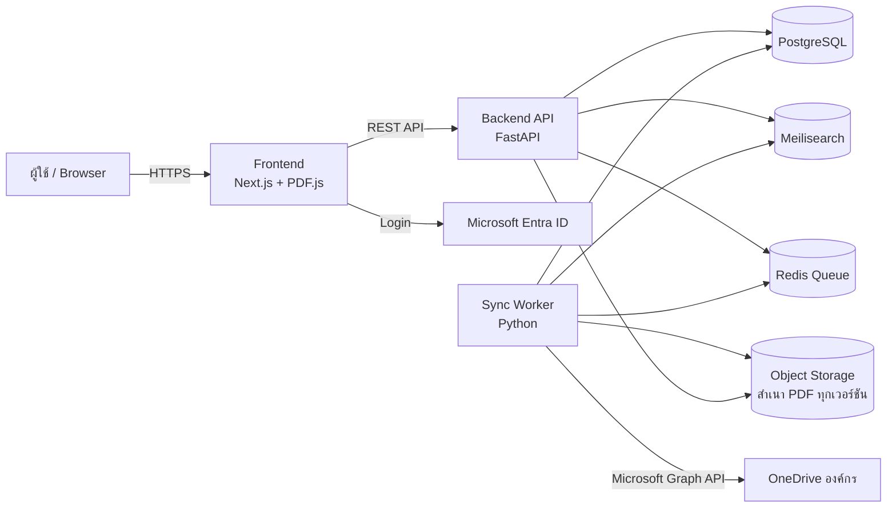
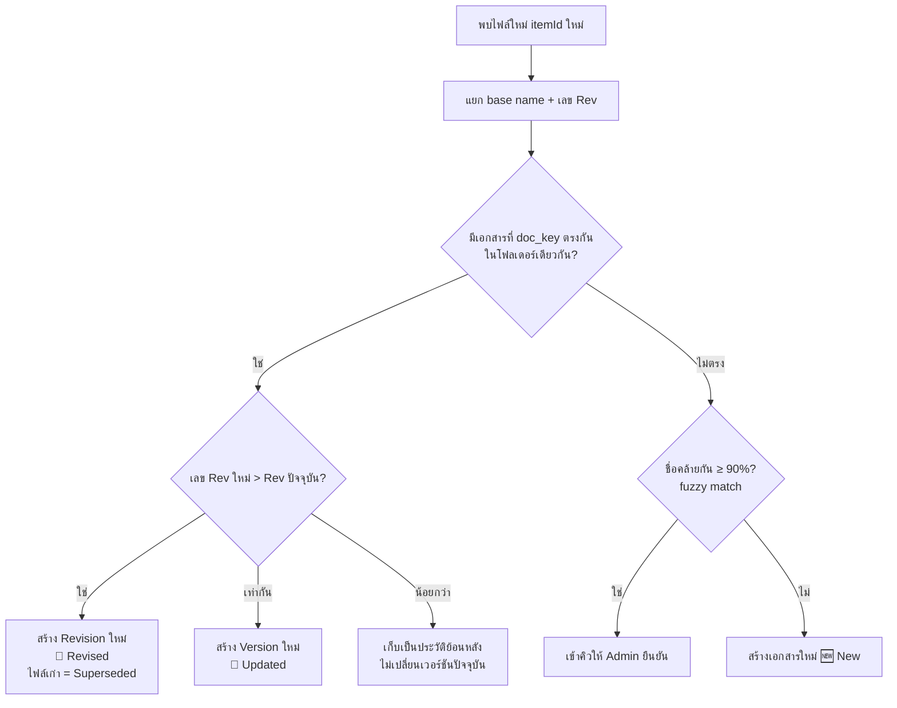
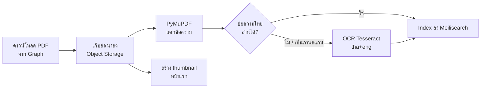
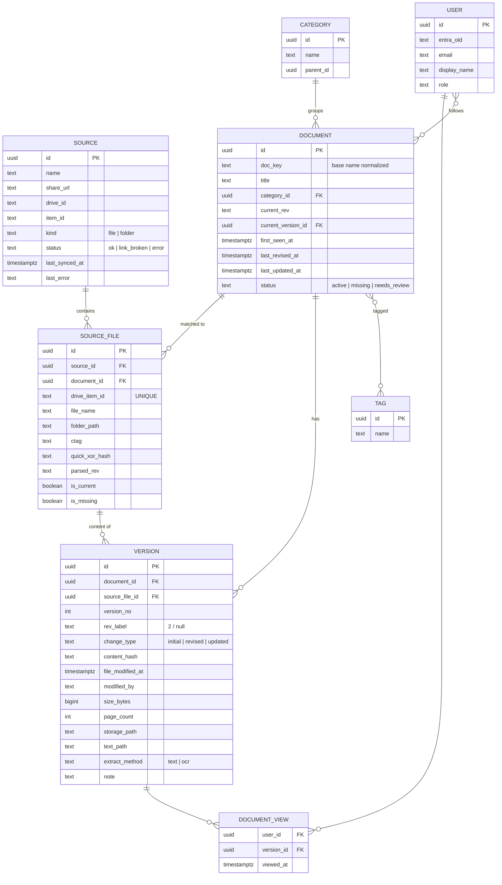

# Document Schematic — System Design

Web app สำหรับรวมเอกสารจาก OneDrive องค์กร (Microsoft 365) ไว้ที่เดียว ค้นหาได้ และติดตามการแก้ไขของเอกสาร (Revised / Updated)

> **v2** — ปรับตามข้อมูลจริงขององค์กร: OneDrive องค์กร + แชร์ลิงก์สาธารณะ, ชื่อไฟล์อิสระต่อท้ายด้วย `Rev.N`, บางครั้งอัปเดตโดยไม่เปลี่ยนเลข Rev, ไฟล์ส่วนใหญ่เป็น PDF

---

## 1. เงื่อนไขของระบบ (จากข้อมูลผู้ใช้)

| หัวข้อ | ข้อเท็จจริง | ผลต่อการออกแบบ |
|---|---|---|
| แหล่งเอกสาร | OneDrive องค์กร (Microsoft 365) แชร์ URL แบบสาธารณะ (Anyone with the link) | ใช้ Microsoft Graph API ด้วย App ขององค์กร → เปิดลิงก์ได้ทั้งไฟล์และโฟลเดอร์ (ดูข้อ 3) |
| เลข Revision | มักมี `Rev.1`, `Rev.2` ท้ายชื่อไฟล์ แต่ไม่เสมอไป | Parse เลข Rev จากชื่อไฟล์ ถ้าไม่มีให้ใช้ลำดับ/วันที่แทน |
| อัปเดตโดยไม่เปลี่ยน Rev | บางครั้งแก้ไฟล์แต่ยังเป็น Rev เดิม | แยก **Revision** (เลข Rev เปลี่ยน) กับ **Update** (เนื้อหาเปลี่ยน แต่เลข Rev เดิม) และอ้างอิงวันที่ของไฟล์ |
| เลขที่เอกสาร | ไม่มีรูปแบบ ตั้งชื่ออิสระ + ต่อท้ายด้วย Rev. | ใช้ **ชื่อไฟล์ที่ตัดส่วน Rev ออก (base name)** เป็นตัวระบุเอกสาร |
| ชนิดไฟล์ | ส่วนใหญ่ PDF | เน้น pipeline ของ PDF: แตกข้อความไทย, OCR สำรอง, preview ด้วย PDF.js, เปรียบเทียบหน้า PDF |

---

## 2. ภาพรวมสถาปัตยกรรม



| ส่วนประกอบ | หน้าที่ | เทคโนโลยี |
|---|---|---|
| Frontend | ค้นหา, รายการเอกสาร, ดู PDF, ประวัติ Revision | Next.js + Tailwind + PDF.js |
| Backend API | REST API, ตรวจสิทธิ์ | **FastAPI (Python)** |
| Sync Worker | ดึงไฟล์จาก OneDrive, แยก Rev, แตกข้อความ PDF, OCR | Python + Celery/RQ, **PyMuPDF**, Tesseract (`tha+eng`) |
| PostgreSQL | metadata เอกสาร, เวอร์ชัน, ผู้ใช้ | PostgreSQL 16 |
| Meilisearch | ค้นหา full-text ภาษาไทย (ตัดคำไทยได้ในตัว + ค้นได้แม้พิมพ์ผิด) | Meilisearch |
| Object Storage | เก็บสำเนา PDF ทุกเวอร์ชัน | MinIO (on-prem) หรือ Azure Blob |

> **ทำไมเลือก Python ทั้ง API และ Worker:** เครื่องมือจัดการ PDF ภาษาไทยและ OCR ของ Python (PyMuPDF, Tesseract) ดีที่สุด ใช้ภาษาเดียวกันทั้งระบบทำให้ดูแลง่าย

> **ทำไมต้องเก็บสำเนา PDF เอง:** เมื่อมีการอัปโหลดไฟล์ Rev ใหม่แล้วลบไฟล์เก่าทิ้ง หรือเขียนทับไฟล์เดิม ประวัติใน OneDrive อาจหายหรือถูกจำกัดจำนวนเวอร์ชัน การเก็บสำเนาเองทำให้เปิดดู/เปรียบเทียบ Rev เก่าได้เสมอ (PDF ส่วนใหญ่ขนาดไม่ใหญ่ ใช้พื้นที่ไม่มาก)

---

## 3. การเชื่อมต่อ OneDrive องค์กร

### 3.1 การยืนยันตัวตน
แม้ลิงก์จะเป็นแบบสาธารณะ แต่ Microsoft Graph API ยังต้องใช้ token เสมอ จึงต้อง:

1. ลงทะเบียน App ใน **Microsoft Entra ID** ของ tenant องค์กร
2. ขอ **Application permission**: `Files.Read.All` (+ `Sites.Read.All` ถ้าเอกสารอยู่ใน SharePoint site) และให้ IT Admin กด **Grant admin consent**
3. Worker ใช้ **Client Credentials flow** (`client_id` + `client_secret`) ทำงานเบื้องหลังได้โดยไม่ต้องมีคน login

> **ถ้าขอ admin consent ไม่ได้:** ใช้บัญชีกลาง (service account) login แบบ Delegated ครั้งเดียว แล้วเก็บ refresh token ไว้ให้ Worker ใช้ต่อ

### 3.2 แปลง URL สาธารณะเป็นไฟล์จริง
```
shareUrl = "https://<org>-my.sharepoint.com/:f:/g/personal/.../EaBc..."
encoded  = "u!" + base64url(shareUrl).rstrip("=")
GET /shares/{encoded}/driveItem        → driveId, itemId, ชื่อ, เป็นไฟล์หรือโฟลเดอร์
```
- ลิงก์ `/:f:/` = โฟลเดอร์, `/:b:/` = PDF, `/:w:/` `/:x:/` = Word/Excel
- บันทึก `driveId` + `itemId` เป็น **Source** ใช้อ้างอิงต่อไป
- ถ้าภายหลังลิงก์ถูกยกเลิก ระบบยังเข้าถึงไฟล์ได้ผ่าน `itemId` (ด้วยสิทธิ์ของ App) แต่จะแจ้งเตือน Admin ว่าลิงก์ใช้ไม่ได้แล้ว

### 3.3 การตรวจจับการเปลี่ยนแปลง — Polling

> ข้อจำกัดของ OneDrive องค์กร: **Delta query ใช้ได้เฉพาะที่ root ของ drive** ใช้กับโฟลเดอร์ที่แชร์มาโดยตรงไม่ได้ และ Webhook ก็แจ้งระดับทั้ง drive

ดังนั้นแนะนำ **Polling แบบไล่โฟลเดอร์** ซึ่งง่ายและเพียงพอสำหรับเอกสารหลักร้อยถึงหลักพันไฟล์:

```
ทุก 15 นาที (ปรับได้) สำหรับแต่ละ Source:
  1. ไล่ GET /drives/{driveId}/items/{itemId}/children (recursive, $select เฉพาะฟิลด์ที่ใช้)
  2. เทียบกับฐานข้อมูลด้วย itemId:
       - itemId ใหม่                     → ไฟล์ใหม่ → เข้ากระบวนการจับคู่เอกสาร (ข้อ 4)
       - cTag/hash เปลี่ยน               → เนื้อหาเปลี่ยน → สร้างเวอร์ชันใหม่
       - เปลี่ยนแค่ชื่อ/ที่อยู่ (eTag เปลี่ยน แต่ cTag เดิม) → อัปเดต metadata (และเลข Rev ถ้าชื่อเปลี่ยน)
       - itemId หายไป                    → mark ว่า Missing (ไม่ลบประวัติ)
```

| ฟิลด์จาก Graph | ใช้ทำอะไร |
|---|---|
| `cTag` | เปลี่ยนเมื่อ **เนื้อหา** ไฟล์เปลี่ยนเท่านั้น → ใช้ตรวจการ Update |
| `file.hashes.quickXorHash` | ยืนยันว่าเนื้อหาเปลี่ยนจริง / ตรวจไฟล์ซ้ำ |
| `fileSystemInfo.lastModifiedDateTime` | วันที่แก้ไขไฟล์จริง (คงวันที่จากเครื่องผู้อัปโหลด) → ใช้แสดงเป็น **วันที่ของเอกสาร** |
| `lastModifiedDateTime` | วันที่ไฟล์เปลี่ยนใน OneDrive |
| `lastModifiedBy.user.displayName` | ผู้แก้ไข |

ทางเลือกในอนาคต: ถ้าต้องการ realtime ให้ใช้ Webhook + Delta ที่ root ของ drive แล้วกรองเฉพาะไฟล์ใต้โฟลเดอร์ที่สนใจ (ต้องใช้สิทธิ์อ่านทั้ง drive)

---

## 4. ระบบ Revision / Update (หัวใจของระบบ)

### 4.1 แนวคิด: แยก 2 ระดับ

```
เอกสาร (Document) — "ขั้นตอนการตรวจรับวัตถุดิบ"
 ├─ Rev.0
 │   └─ v1  (12/01/2026)
 ├─ Rev.1
 │   ├─ v2  (03/05/2026)
 │   └─ v3  (20/05/2026)   ← Update: แก้เนื้อหาแต่ยังเป็น Rev.1
 └─ Rev.2                  ← Revised: เลข Rev เปลี่ยน
     └─ v4  (24/10/2026)   ← เวอร์ชันปัจจุบัน
```

| ระดับ | เกิดเมื่อ | ป้ายที่แสดง |
|---|---|---|
| **Revision** | เลข Rev ในชื่อไฟล์เพิ่มขึ้น (Rev.1 → Rev.2) | 🔄 **Revised** |
| **Version (Update)** | เนื้อหาไฟล์เปลี่ยน (`cTag`/hash เปลี่ยน) แต่เลข Rev เดิมหรือไม่มีเลข Rev | 📝 **Updated** |

การแสดงผลบนหน้าเว็บ: **`Rev.2 · อัปเดต 24 ต.ค. 2026`** — ผู้ใช้เห็นทั้งเลข Rev และวันที่ล่าสุด จึงรู้ได้แม้มีการแก้โดยไม่เปลี่ยนเลข Rev

### 4.2 แยกเลข Rev ออกจากชื่อไฟล์

ตัวอย่างชื่อไฟล์และผลลัพธ์:

| ชื่อไฟล์ | Base name (ตัวระบุเอกสาร) | Rev |
|---|---|---|
| `ขั้นตอนการตรวจรับวัตถุดิบ Rev.2.pdf` | `ขั้นตอนการตรวจรับวัตถุดิบ` | 2 |
| `Machine Setup_Rev.1.pdf` | `machine setup` | 1 |
| `QC Checklist (Rev 3).pdf` | `qc checklist` | 3 |
| `แบบฟอร์มขอซื้อ-REV.10.pdf` | `แบบฟอร์มขอซื้อ` | 10 |
| `คู่มือพนักงานใหม่.pdf` | `คู่มือพนักงานใหม่` | — (ไม่มี) |

Regex เริ่มต้น (ไม่สนตัวพิมพ์เล็ก/ใหญ่ ตั้งค่าเพิ่มได้ในหน้า Admin):
```python
REV_PATTERN = re.compile(
    r"[\s_\-\.\(\[]*(?<![A-Za-z])rev(?:ision)?\s*\.?\s*[-_:]?\s*(\d+|[A-Z])(?![A-Za-z0-9])[\)\]]?",
    re.IGNORECASE,
)
# ใช้ match ตัวสุดท้ายในชื่อไฟล์ (หลังตัดนามสกุล)
# ไม่จับคำอย่าง "Review", "Revenue" และจับได้แม้ติดกับอักษรไทย เช่น "ขั้นตอนRev.5"
```

การทำ **normalize** base name: ตัดนามสกุลไฟล์ → ตัดส่วน Rev → ตัวเล็กทั้งหมด → แปลง `_` `-` และช่องว่างซ้ำเป็นช่องว่างเดียว → trim
ผลลัพธ์เก็บเป็น `doc_key` ใช้จับคู่เอกสาร

### 4.3 การจับคู่ไฟล์ใหม่เข้ากับเอกสารเดิม



กรณีที่รองรับ:

| สถานการณ์ | ระบบทำอะไร |
|---|---|
| อัปโหลด `ABC Rev.2.pdf` ใหม่ ข้าง `ABC Rev.1.pdf` | Revision ใหม่ → Rev.2 เป็นปัจจุบัน, Rev.1 ยังเปิดดูได้ในประวัติ |
| เปลี่ยนชื่อไฟล์เดิมจาก Rev.1 เป็น Rev.2 และแก้เนื้อหา | itemId เดิม, Rev เพิ่ม → Revision ใหม่ |
| แก้เนื้อหาไฟล์ `ABC Rev.1.pdf` โดยไม่เปลี่ยนชื่อ | Version ใหม่ภายใต้ Rev.1 → 📝 Updated + วันที่ใหม่ |
| ไฟล์ไม่มีเลข Rev แล้วถูกแก้ | Version ใหม่ → 📝 Updated + วันที่ใหม่ |
| เปลี่ยนชื่อไฟล์อย่างเดียว เนื้อหาเดิม | อัปเดตชื่อ ไม่สร้างเวอร์ชันใหม่ |
| ลบไฟล์เก่าทิ้งหลังอัปโหลด Rev ใหม่ | ไม่กระทบ เพราะมีสำเนาใน Object Storage |
| Admin ไม่เห็นด้วยกับการจับคู่ | กด "แยกเป็นเอกสารใหม่" / "รวมเข้ากับเอกสาร…" ได้ |

### 4.4 ป้ายสถานะ

| ป้าย | เงื่อนไข (N ตั้งค่าได้ ค่าเริ่มต้น 14 วัน) |
|---|---|
| 🆕 **New** | เอกสารเข้าระบบภายใน N วัน |
| 🔄 **Revised** | เลข Rev เพิ่มขึ้นภายใน N วัน |
| 📝 **Updated** | เนื้อหาเปลี่ยนโดยเลข Rev เดิม ภายใน N วัน |
| 🔵 **ยังไม่ได้อ่าน** | ผู้ใช้คนนี้ยังไม่เคยเปิดเวอร์ชันล่าสุด |
| ⚠️ **Missing** | ไฟล์หายจาก OneDrive (ถูกลบ/ย้ายออกนอกโฟลเดอร์) |
| ⚪ **Superseded** | ไฟล์ Rev เก่าที่ยังค้างอยู่ใน OneDrive (แสดงในประวัติเท่านั้น ไม่แสดงในผลค้นหาหลัก) |

---

## 5. Pipeline สำหรับ PDF



### 5.1 ปัญหาที่พบบ่อยกับ PDF ภาษาไทย
- **สระ/วรรณยุกต์เพี้ยน หรือได้ตัวอักษรแปลกๆ** เมื่อแตกข้อความ เกิดจากฟอนต์ใน PDF ไม่มีตาราง ToUnicode → ตรวจด้วย heuristic (สัดส่วนอักขระไทยที่ถูกต้อง / อักขระขยะ) ถ้าต่ำกว่าเกณฑ์ให้ OCR แทน
- **PDF สแกน** ไม่มีข้อความเลย → OCR อัตโนมัติ
- OCR ช้า (~2–5 วินาที/หน้า) → ทำในคิวแยก ไฟล์ค้นจากชื่อได้ทันที ส่วนค้นจากเนื้อหาจะพร้อมหลัง OCR เสร็จ

### 5.2 การดูและเปรียบเทียบ PDF
- **Preview:** เปิดใน PDF.js บนเว็บโดยตรง (ไฟล์มาจาก Object Storage ผ่าน API ของเรา ไม่ต้องพึ่งลิงก์ OneDrive)
- **เปรียบเทียบ 2 เวอร์ชัน:**
  - **เทียบข้อความ** — ไฮไลต์บรรทัดที่เพิ่ม/ลบ
  - **เทียบภาพทีละหน้า** — render หน้า PDF เป็นภาพแล้ววางคู่กัน / overlay ไฮไลต์จุดต่าง (เหมาะกับเอกสารที่มีตาราง แบบฟอร์ม หรือรูป)
  - สรุปสั้นๆ: "เปลี่ยน 3 หน้า: หน้า 2, 5, 7"

---

## 6. Data Model (PostgreSQL)



แนวคิดสำคัญ: **SOURCE_FILE** = ไฟล์จริงแต่ละไฟล์ใน OneDrive (หลายไฟล์อาจเป็นเอกสารเดียวกันคนละ Rev), **DOCUMENT** = เอกสารเชิงตรรกะที่ผู้ใช้เห็น, **VERSION** = ทุกครั้งที่เนื้อหาเปลี่ยน

Index สำคัญ: `source_file(drive_item_id) UNIQUE`, `document(doc_key)`, `version(document_id, version_no) UNIQUE`, `document(last_updated_at DESC)`

---

## 7. ระบบค้นหา

### 7.1 Index ใน Meilisearch (`documents`) — 1 record ต่อ 1 เอกสาร (เวอร์ชันปัจจุบัน)
```json
{
  "id": "doc uuid",
  "title": "ขั้นตอนการตรวจรับวัตถุดิบ",
  "file_name": "ขั้นตอนการตรวจรับวัตถุดิบ Rev.2.pdf",
  "folder_path": "QA/Procedures",
  "category": "Procedure",
  "tags": ["QC", "Incoming"],
  "content": "ข้อความจาก PDF (ตัดไม่เกิน ~200KB)",
  "current_rev": "2",
  "last_updated_at": 1761264000,
  "change_badge": "revised",
  "page_count": 12
}
```
- `searchableAttributes` เรียงตามน้ำหนัก: `title` → `file_name` → `tags` → `folder_path` → `content`
- `filterableAttributes`: `category`, `tags`, `folder_path`, `change_badge`, `last_updated_at`
- `sortableAttributes`: `last_updated_at`, `title`
- เปิด highlight + crop เพื่อแสดงข้อความรอบคำที่ค้นเจอ และบอก **หมายเลขหน้า** ที่พบ (เก็บข้อความแยกหน้าไว้ใน index ย่อย `pages` เพื่อกดแล้วกระโดดไปหน้านั้นใน PDF.js)

### 7.2 เนื่องจากไม่มีเลขเอกสาร
- ใช้ **โฟลเดอร์ใน OneDrive เป็นหมวดหมู่เริ่มต้น** อัตโนมัติ (Admin ปรับ/เพิ่ม tag ได้)
- มีค้นหาแบบพิมพ์แล้วแนะนำทันที (search-as-you-type) จากชื่อเอกสาร

---

## 8. API (REST)

| Method | Path | คำอธิบาย |
|---|---|---|
| GET | `/api/documents?q=&category=&tag=&badge=revised&sort=` | ค้นหา / แสดงรายการ |
| GET | `/api/documents/:id` | รายละเอียด + เวอร์ชันปัจจุบัน |
| GET | `/api/documents/:id/versions` | ประวัติ Rev/Version ทั้งหมด |
| GET | `/api/versions/:id/file` | สตรีม PDF ของเวอร์ชันนั้น (สำหรับ PDF.js / ดาวน์โหลด) |
| GET | `/api/versions/:id/thumbnail` | รูปหน้าแรก |
| GET | `/api/documents/:id/compare?from=&to=&mode=text\|visual` | เปรียบเทียบ 2 เวอร์ชัน |
| POST | `/api/versions/:id/view` | บันทึกว่าผู้ใช้เปิดอ่านแล้ว |
| POST/DELETE | `/api/documents/:id/follow` | ติดตาม / เลิกติดตาม |
| GET | `/api/updates?since=` | ฟีดเอกสารที่ Revised/Updated ล่าสุด |
| **Admin** | | |
| POST | `/api/admin/sources` `{ share_url }` | เพิ่มลิงก์ OneDrive (ตรวจลิงก์ + แสดงตัวอย่างไฟล์ก่อนยืนยัน) |
| POST | `/api/admin/sources/:id/sync` | สั่ง sync ทันที |
| GET | `/api/admin/sources` | สถานะ sync, error |
| GET | `/api/admin/review-queue` | รายการไฟล์ที่ระบบจับคู่ไม่แน่ใจ |
| POST | `/api/admin/source-files/:id/assign` `{ document_id \| new }` | ยืนยัน/แก้การจับคู่ |
| PATCH | `/api/admin/documents/:id` | แก้ชื่อ, หมวด, tag, หมายเหตุการแก้ไข |
| PUT | `/api/admin/settings/rev-patterns` | ตั้งค่า regex เลข Rev |

---

## 9. หน้าจอ (UI)

1. **หน้าแรก**
   - ช่องค้นหาขนาดใหญ่ (แนะนำชื่อขณะพิมพ์)
   - **"อัปเดตล่าสุด"** — ไทม์ไลน์เอกสารที่ 🔄 Revised / 📝 Updated / 🆕 New ล่าสุด
   - หมวดหมู่ตามโฟลเดอร์
2. **หน้าค้นหา / รายการเอกสาร**
   - การ์ดหรือตาราง: thumbnail | ชื่อเอกสาร | `Rev.2` | วันที่อัปเดต | ป้ายสถานะ | หมวด
   - Filter: หมวด, tag, สถานะ (Revised / Updated / New), ช่วงวันที่
   - ข้อความที่ค้นเจอ + "พบในหน้า 3, 7"
3. **หน้ารายละเอียดเอกสาร**
   - PDF viewer (PDF.js) เต็มจอ
   - แถบด้านข้าง: ประวัติแบบ timeline (Rev → Version พร้อมวันที่และผู้แก้ไข)
   - ปุ่ม: เปิดใน OneDrive, ดาวน์โหลด, ติดตาม, **เปรียบเทียบกับเวอร์ชันก่อนหน้า**
4. **หน้าเปรียบเทียบ** — วางคู่ซ้าย/ขวา, โหมดข้อความ / โหมดภาพ, ปุ่มไปยังหน้าที่เปลี่ยน
5. **หน้า Admin** — จัดการลิงก์ OneDrive, สถานะ sync, คิวจับคู่, หมวด/tag, ตั้งค่า regex

---

## 10. ความปลอดภัย
- Login ผ่าน Entra ID (OIDC) จำกัดเฉพาะบัญชีใน tenant องค์กร
- Role: `viewer`, `editor` (แก้ metadata/หมายเหตุ), `admin` (จัดการลิงก์และการจับคู่)
- ผู้ใช้ไม่ต้องเข้าถึง OneDrive โดยตรง: ไฟล์ส่งผ่าน API ของเราหลังตรวจ login แล้ว
- `client_secret` เก็บใน environment / secret manager ไม่ commit ลง repo และหมุนเวียนก่อนหมดอายุ
- ข้อควรระวัง: ลิงก์สาธารณะ (Anyone with the link) ใครได้ลิงก์ก็เปิดได้ — ระบบนี้ไม่จำเป็นต้องใช้ลิงก์แบบสาธารณะ ใช้ลิงก์แบบ "People in your organization" ก็ได้ เพราะ App มีสิทธิ์อ่านผ่าน Graph อยู่แล้ว แนะนำให้พิจารณาเปลี่ยนเพื่อความปลอดภัยของเอกสาร

---

## 11. Deployment

```
docker-compose.yml
├── web          (Next.js)
├── api          (FastAPI)
├── worker       (Python: sync + PDF extract)
├── worker-ocr   (Python + Tesseract tha — แยกเพราะใช้ CPU สูง)
├── scheduler    (สั่ง sync ทุก 15 นาที)
├── postgres
├── redis
├── meilisearch
└── minio
```
- เนื่องจากใช้ Polling จึง **ไม่ต้องมี public endpoint สำหรับ webhook** — วางบนเซิร์ฟเวอร์ภายในองค์กรได้ ขอแค่ออก internet ไปที่ `graph.microsoft.com` และ `login.microsoftonline.com`
- สำรองข้อมูล PostgreSQL + MinIO รายวัน

---

## 12. แผนการพัฒนา

| Phase | งาน | ผลลัพธ์ |
|---|---|---|
| **1. MVP** | ลงทะเบียน Entra App, เพิ่มลิงก์โฟลเดอร์/ไฟล์, Polling sync, แยก Rev จากชื่อไฟล์ + จับคู่เอกสาร, เก็บสำเนา PDF, ค้นจากชื่อ, ป้าย Revised/Updated/New, หน้า list + PDF viewer + ประวัติ | ใช้งานจริงได้ |
| **2. Search เนื้อหา** | แตกข้อความ PDF ไทย, Meilisearch, highlight + เลขหน้า, OCR สำหรับ PDF สแกน | ค้นจากเนื้อหาได้ |
| **3. เปรียบเทียบ + Admin** | เทียบข้อความ/ภาพ, คิวจับคู่, สถานะยังไม่ได้อ่าน, หมายเหตุการแก้ไข | ตรวจสอบการเปลี่ยนแปลงได้ละเอียด |
| **4. แจ้งเตือน** | ติดตามเอกสาร, แจ้งเตือน Email / Microsoft Teams, สรุปรายสัปดาห์ | ผู้ใช้รู้ทันทีเมื่อเอกสารเปลี่ยน |

---

## 13. สิ่งที่ต้องเตรียมก่อนเริ่ม
1. ติดต่อ IT Admin ของ Microsoft 365 เพื่อ **ลงทะเบียน App + Grant admin consent** สิทธิ์ `Files.Read.All` (และ `Sites.Read.All` ถ้าใช้ SharePoint)
2. ตัวอย่างลิงก์ OneDrive จริง 1–2 ลิงก์ และ **ตัวอย่างชื่อไฟล์ 20–30 ชื่อ** เพื่อทดสอบ regex เลข Rev
3. ตัวอย่าง PDF 3–5 ไฟล์ (มีทั้งแบบพิมพ์และแบบสแกน) เพื่อทดสอบการแตกข้อความไทย
4. เซิร์ฟเวอร์สำหรับ deploy (on-prem หรือ cloud) — สเปกเริ่มต้น 4 vCPU / 8 GB RAM / ดิสก์ตามปริมาณ PDF × 3 เท่า
