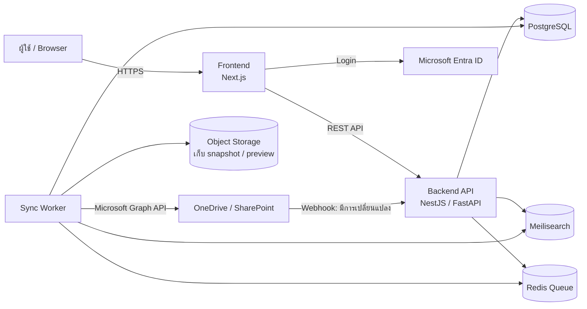
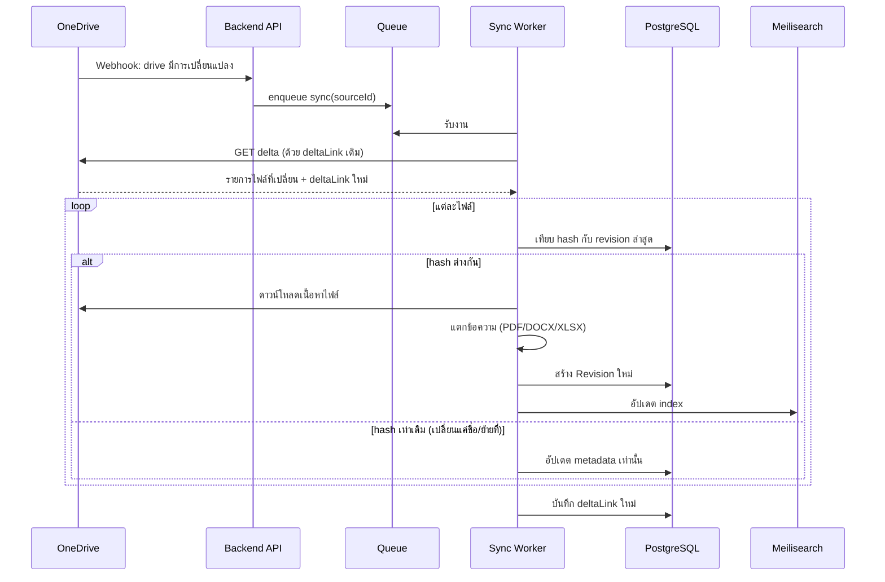
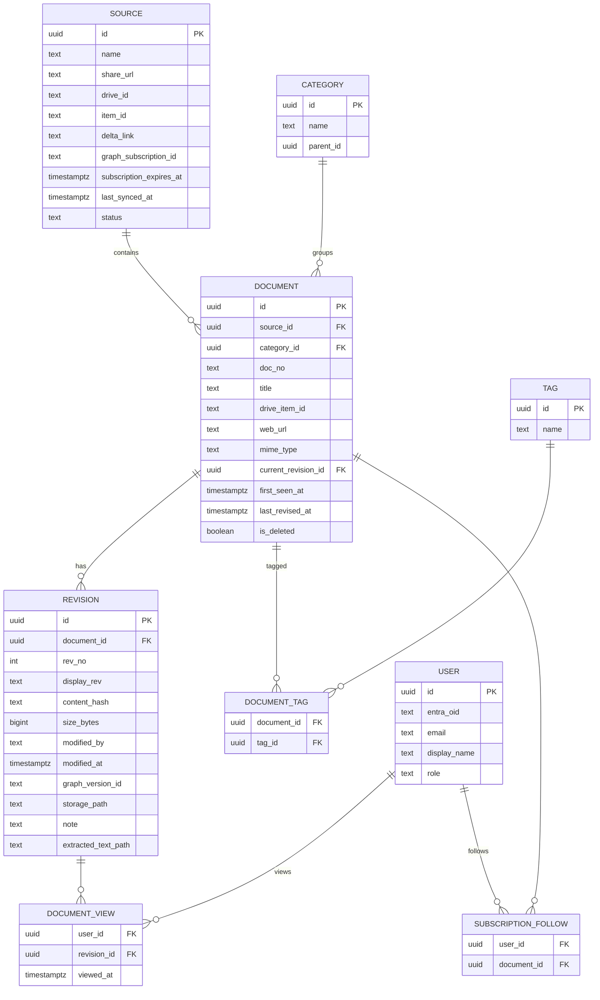

# Document Schematic — System Design

Web app สำหรับรวมเอกสารจาก OneDrive / SharePoint ไว้ที่เดียว ค้นหาได้ และติดตามการแก้ไขของเอกสาร (Revised)

---

## 1. เป้าหมายและขอบเขต

| # | ความต้องการ | รายละเอียด |
|---|---|---|
| F1 | รวมเอกสาร | ผู้ดูแลเพิ่ม URL ของไฟล์หรือโฟลเดอร์ OneDrive แล้วระบบดึงรายการเอกสารเข้ามาเอง |
| F2 | ค้นหา | ค้นจากชื่อไฟล์, เลขที่เอกสาร, หมวดหมู่, tag และ **เนื้อหาในไฟล์** (PDF, Word, Excel) รองรับภาษาไทย |
| F3 | ติดตาม Update | ตรวจจับเมื่อไฟล์ใน OneDrive ถูกแก้ไข แล้วสร้าง Revision ใหม่ (Rev 0, Rev 1, Rev 2…) |
| F4 | แสดง Revised | แสดงป้าย **Revised** บนเอกสารที่เพิ่งถูกแก้ไข, ดูประวัติ Revision และเปิดดูเวอร์ชันเก่าได้ |
| F5 | สิทธิ์การเข้าถึง | Login ด้วยบัญชี Microsoft (บัญชีองค์กร) |

**ไม่อยู่ในขอบเขตระยะแรก:** การแก้ไขเอกสารในเว็บ (ให้ไปแก้ใน OneDrive/Office ตามเดิม), workflow อนุมัติเอกสาร

---

## 2. ภาพรวมสถาปัตยกรรม



| ส่วนประกอบ | หน้าที่ | เทคโนโลยีที่แนะนำ |
|---|---|---|
| Frontend | หน้าค้นหา, รายการเอกสาร, ประวัติ Revision, หน้า Admin | Next.js + Tailwind |
| Backend API | REST API, ตรวจสิทธิ์, รับ webhook จาก Graph | NestJS (TypeScript) หรือ FastAPI (Python) |
| Sync Worker | ดึงข้อมูลจาก OneDrive, ตรวจการเปลี่ยนแปลง, แตกข้อความจากไฟล์ | Node/Python + BullMQ หรือ Celery |
| PostgreSQL | เก็บ metadata เอกสาร, revision, ผู้ใช้ | PostgreSQL 16 |
| Meilisearch | full-text search (ตัดคำภาษาไทยได้ในตัว) | Meilisearch |
| Redis | คิวงาน sync / extract | Redis |
| Object Storage | เก็บสำเนาไฟล์แต่ละ Revision (ไม่บังคับ) | MinIO / Azure Blob |

> ทำไมใช้ Meilisearch แทน Full-text search ของ PostgreSQL: PostgreSQL ตัดคำภาษาไทยเองไม่ได้ ส่วน Meilisearch ตัดคำภาษาไทยได้ในตัว และรองรับการค้นแม้พิมพ์ผิด (typo tolerance)

---

## 3. การเชื่อมต่อ OneDrive (Microsoft Graph API)

### 3.1 การยืนยันตัวตน
1. ลงทะเบียน App ใน **Microsoft Entra ID** (Azure AD)
2. Permission ที่ต้องใช้:
   - `Files.Read.All`, `Sites.Read.All` (Application permission สำหรับ Worker ดึงไฟล์เบื้องหลัง)
   - `User.Read` (Delegated สำหรับ Login ผู้ใช้)
3. Worker ใช้ **Client Credentials flow** (ไม่ต้องมีผู้ใช้ login อยู่)

> ถ้าเป็น **OneDrive ส่วนตัว (Personal)** ไม่ใช่บัญชีองค์กร จะใช้ Application permission ไม่ได้ ต้องใช้ Delegated + refresh token ของบัญชีที่เป็นเจ้าของไฟล์แทน

### 3.2 แปลง URL เป็นไฟล์จริง
ผู้ดูแลวาง Share link เช่น `https://xxx-my.sharepoint.com/:f:/g/personal/...`

```
1. encoded = "u!" + base64url(shareUrl)   (ตัด '=' ท้ายออก)
2. GET /shares/{encoded}/driveItem         → ได้ driveId + itemId
3. ถ้าเป็นโฟลเดอร์ → GET /drives/{driveId}/items/{itemId}/children (วนลงโฟลเดอร์ย่อย)
```

บันทึก `driveId` + `itemId` ไว้เป็น **Source** ใช้อ้างอิงต่อไป (ไม่ใช้ URL ซ้ำ เพราะ URL อาจถูกยกเลิกได้)

### 3.3 การตรวจจับการเปลี่ยนแปลง

ใช้ 2 กลไกร่วมกัน:

| กลไก | ใช้ทำอะไร |
|---|---|
| **Delta query** `GET /drives/{driveId}/items/{folderId}/delta` | ได้เฉพาะไฟล์ที่เปลี่ยนตั้งแต่ครั้งก่อน เก็บ `deltaLink` ไว้ใช้รอบถัดไป ประหยัดกว่าดึงทั้งหมด |
| **Webhook** `POST /subscriptions` (resource = drive root) | Graph แจ้งเข้ามาทันทีเมื่อมีการเปลี่ยนแปลง → สั่ง Worker ไปเรียก delta |
| **Cron สำรอง** ทุก 15–30 นาที | กันกรณี webhook หลุด, subscription หมดอายุ (ต้องต่ออายุก่อนครบ ~29 วัน) |



---

## 4. ระบบ Revision

### 4.1 หลักการ
- **ตัดสินว่าเป็น Revision ใหม่จาก content hash** (`file.hashes.quickXorHash` หรือ `sha256Hash` ที่ Graph ส่งมา) ไม่ใช่จาก `lastModifiedDateTime` เพราะการเปลี่ยนชื่อ/ย้ายโฟลเดอร์ก็ทำให้วันที่เปลี่ยนได้
- ไฟล์ที่เข้าระบบครั้งแรก = **Rev 0**, แก้ไขครั้งถัดไป = Rev 1, 2, 3…
- ถ้าชื่อไฟล์มีเลข Revision อยู่แล้ว (เช่น `WI-PRD-001_RevC.pdf`) ให้ parse ด้วย regex ที่ตั้งค่าได้ แล้วแสดงเลขนั้นแทน (`display_rev`)
- ทางเลือก: ดึงประวัติเวอร์ชันย้อนหลังจาก OneDrive ด้วย `GET /drives/{d}/items/{i}/versions` มาสร้าง Revision ย้อนหลังตอนเพิ่มเอกสารครั้งแรก

### 4.2 กรณีชื่อไฟล์เปลี่ยนตาม Revision
หลายองค์กรอัปโหลดไฟล์ใหม่แทนการแก้ไฟล์เดิม เช่น `ABC_Rev1.pdf` → `ABC_Rev2.pdf` (คนละ itemId) ระบบจะจับคู่เป็นเอกสารเดียวกันด้วย **เลขที่เอกสาร (Document No.)** ที่ parse จากชื่อไฟล์ ถ้าจับคู่ไม่ได้จะเข้าคิวให้ Admin ยืนยัน

### 4.3 การแสดงสถานะ

| ป้าย | เงื่อนไข |
|---|---|
| 🆕 **New** | เอกสารเข้าระบบภายใน N วัน (ตั้งค่าได้ ค่าเริ่มต้น 7 วัน) |
| 🔄 **Revised** | มี Revision ใหม่ภายใน N วัน |
| 👁 **ยังไม่ได้อ่าน** | ผู้ใช้คนนี้ยังไม่เคยเปิด Revision ล่าสุด (จากตาราง `document_views`) |
| ⚠️ **Missing** | ไฟล์ถูกลบ/ย้ายออกจาก OneDrive (soft delete ไม่ลบประวัติ) |

หน้าประวัติ Revision แสดง: เลข Rev, วันที่, ผู้แก้ไข (`lastModifiedBy` จาก Graph), ขนาดไฟล์, หมายเหตุการแก้ไข (Admin ใส่เพิ่มได้) และ **เปรียบเทียบข้อความ** ระหว่าง 2 Revision (text diff จากข้อความที่แตกไว้)

---

## 5. Data Model (PostgreSQL)



Index สำคัญ: `document(doc_no)`, `document(source_id, drive_item_id) UNIQUE`, `revision(document_id, rev_no) UNIQUE`, `document(last_revised_at DESC)`

---

## 6. ระบบค้นหา

### 6.1 Index ใน Meilisearch (`documents`)
```json
{
  "id": "doc uuid",
  "doc_no": "WI-PRD-001",
  "title": "วิธีการตรวจสอบชิ้นงาน",
  "file_name": "WI-PRD-001_RevC.pdf",
  "category": "Work Instruction",
  "tags": ["QC", "Production"],
  "content": "ข้อความที่แตกจากไฟล์ (ตัดไม่เกิน ~100KB)",
  "display_rev": "C",
  "last_revised_at": 1761350400,
  "is_revised_recently": true,
  "file_type": "pdf"
}
```
- `searchableAttributes` (เรียงตามน้ำหนัก): `doc_no` → `title` → `file_name` → `tags` → `content`
- `filterableAttributes`: `category`, `tags`, `file_type`, `is_revised_recently`, `last_revised_at`
- `sortableAttributes`: `last_revised_at`, `title`
- เปิด highlight เพื่อแสดงข้อความที่ค้นเจอใน content

### 6.2 การแตกข้อความจากไฟล์
| ชนิดไฟล์ | เครื่องมือ |
|---|---|
| PDF (มีข้อความ) | `pdfplumber` / `pdf-parse` |
| PDF สแกน (ภาพ) | OCR ด้วย Tesseract (`tha+eng`) — เปิดเป็น option เพราะช้า |
| DOCX / XLSX / PPTX | `python-docx`, `openpyxl` หรือ **Apache Tika** ตัวเดียวจบ |
| อื่นๆ | ดึงได้แค่ metadata |

> ทางลัด: Graph API แปลงไฟล์ Office เป็น PDF ให้ได้ด้วย `GET /items/{id}/content?format=pdf` ใช้ทำ preview ได้

---

## 7. API (REST)

| Method | Path | คำอธิบาย |
|---|---|---|
| GET | `/api/documents?q=&category=&tag=&revised=true&page=` | ค้นหา / แสดงรายการ |
| GET | `/api/documents/:id` | รายละเอียด + Revision ล่าสุด |
| GET | `/api/documents/:id/revisions` | ประวัติ Revision |
| GET | `/api/documents/:id/revisions/:revId/download` | ดาวน์โหลด / เปิดไฟล์ Revision นั้น |
| GET | `/api/documents/:id/diff?from=&to=` | เปรียบเทียบข้อความ 2 Revision |
| POST | `/api/documents/:id/view` | บันทึกว่าผู้ใช้เปิดอ่านแล้ว |
| POST/DELETE | `/api/documents/:id/follow` | ติดตาม / เลิกติดตามเอกสาร |
| GET | `/api/updates?since=` | ฟีดเอกสารที่ Revised ล่าสุด |
| **Admin** | | |
| POST | `/api/admin/sources` | เพิ่ม OneDrive URL |
| POST | `/api/admin/sources/:id/sync` | สั่ง sync ทันที |
| GET | `/api/admin/sources` | สถานะ sync ของแต่ละ source |
| PATCH | `/api/admin/documents/:id` | แก้ category, tag, doc_no, หมายเหตุ |
| POST | `/api/webhooks/graph` | รับ notification จาก Microsoft Graph |

---

## 8. หน้าจอ (UI)

1. **หน้าแรก / Dashboard**
   - ช่องค้นหาขนาดใหญ่
   - การ์ด "อัปเดตล่าสุด" — รายการเอกสารที่ Revised ในสัปดาห์นี้
   - จำนวนเอกสารแยกตามหมวด
2. **หน้าค้นหา / รายการเอกสาร**
   - ตาราง: Doc No. | ชื่อเอกสาร | หมวด | Rev | วันที่แก้ไขล่าสุด | ป้าย Revised/New
   - Filter ด้านข้าง: หมวด, tag, ชนิดไฟล์, ช่วงวันที่, "เฉพาะที่ Revised"
   - แสดงข้อความที่ค้นเจอ (highlight)
3. **หน้ารายละเอียดเอกสาร**
   - Preview ไฟล์ (PDF viewer / Office Online embed)
   - ปุ่ม "เปิดใน OneDrive", "ดาวน์โหลด", "ติดตาม"
   - Timeline ประวัติ Revision + ปุ่มเปรียบเทียบ
4. **หน้า Admin**
   - จัดการ Source (เพิ่ม URL, ดูสถานะ sync, error log)
   - จัดการหมวดหมู่ / tag / รูปแบบ regex ของเลขเอกสาร
   - คิว "จับคู่เอกสาร" ที่ระบบไม่แน่ใจ

---

## 9. การแจ้งเตือน (Phase 2)
- ผู้ใช้กด "ติดตาม" เอกสาร → เมื่อมี Revision ใหม่ส่งแจ้งเตือนทาง Email / Microsoft Teams / LINE Notify ทางเลือก
- สรุปรายสัปดาห์ (Weekly digest) เอกสารที่ Revised

---

## 10. ความปลอดภัย
- Login ผ่าน Entra ID (OIDC) เท่านั้น จำกัดเฉพาะ tenant ขององค์กร
- Role: `viewer`, `editor` (แก้ metadata), `admin` (จัดการ source)
- ตรวจ `clientState` ของ webhook และตอบ `validationToken` ตามข้อกำหนด Graph
- เก็บ client secret ใน secret manager / env ไม่ commit ลง repo
- (ทางเลือก) เคารพสิทธิ์ใน OneDrive: ตรวจ permission ของไฟล์ผ่าน Graph ก่อนแสดงให้ผู้ใช้ — ซับซ้อนกว่า ระยะแรกอาจให้ทุกคนในองค์กรเห็นเอกสารที่ Admin เพิ่มไว้ทั้งหมด

---

## 11. Deployment

```
docker-compose.yml
├── web        (Next.js)
├── api        (Backend)
├── worker     (Sync worker)
├── postgres
├── redis
├── meilisearch
└── minio      (ถ้าเก็บสำเนาไฟล์)
```
- Webhook ต้องมี public HTTPS endpoint (ใช้ reverse proxy เช่น Caddy/Nginx หรือ deploy บน Azure App Service)
- ระหว่างพัฒนาใช้ ngrok / Cloudflare Tunnel รับ webhook

---

## 12. แผนการพัฒนา

| Phase | งาน | ผลลัพธ์ |
|---|---|---|
| **1. MVP** | ลงทะเบียน Entra App, เพิ่ม Source จาก URL, sync ด้วย cron + delta, ตาราง document/revision, ค้นจากชื่อ/doc no., ป้าย Revised, หน้า list + detail | ใช้งานได้จริงขั้นพื้นฐาน |
| **2. Search** | Meilisearch, แตกข้อความ PDF/Office, highlight, filter | ค้นจากเนื้อหาได้ |
| **3. Realtime + History** | Graph webhook, ดึง version ย้อนหลัง, เก็บ snapshot, diff ระหว่าง Revision, สถานะ "ยังไม่ได้อ่าน" | ติดตามการเปลี่ยนแปลงได้ละเอียด |
| **4. Notification** | ติดตามเอกสาร, แจ้งเตือน Email/Teams, weekly digest | ผู้ใช้รู้ทันทีเมื่อเอกสารเปลี่ยน |
| **5. ขั้นสูง** | OCR, ตรวจสิทธิ์ตาม OneDrive, workflow อนุมัติ | ตามความต้องการ |

---

## 13. คำถามที่ต้องยืนยันก่อนเริ่มพัฒนา
1. OneDrive เป็นบัญชี **องค์กร (Microsoft 365 / SharePoint)** หรือ **ส่วนตัว**? (มีผลกับวิธี authentication)
2. เพิ่มเอกสารเป็น **ไฟล์ทีละไฟล์** หรือ **ทั้งโฟลเดอร์**?
3. การ Revise ทำโดย **แก้ไฟล์เดิม** หรือ **อัปโหลดไฟล์ใหม่ชื่อใหม่** (`_Rev1`, `_Rev2`)?
4. มี **รูปแบบเลขที่เอกสาร** ที่ใช้อยู่หรือไม่ (เช่น `WI-XXX-000`)?
5. จำนวนเอกสารโดยประมาณ และชนิดไฟล์หลัก (PDF / Word / Excel / แบบสแกน)?
6. ผู้ใช้ทุกคนเห็นเอกสารทั้งหมด หรือต้องแบ่งสิทธิ์ตามแผนก?
